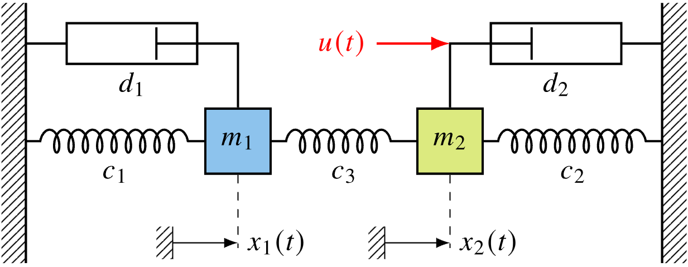
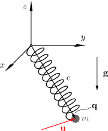
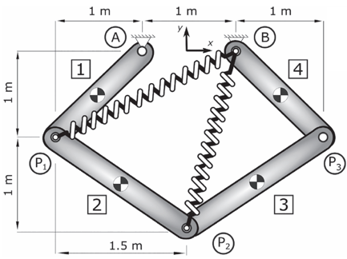

# FreeDyn Optimization Toolbox
Adjoint-based optimization toolbox for multibody systems using the FreeDyn API

```python
from optimization_toolbox import OptimCtrl, TimeOptimCtrl, ParamIdent

Opt_TB = <ClassName>(fds_path, fds_name,
                     fds_dForce_dparam_name, fds_meas_name, fds_ctrl_name,
                     num_ctrls, num_ctrl_grid_nodes, num_FD_pars,
                     final_time, final_state,
                     path_FDdll)
```
[`Parameters of FreeDyn Optimization Toolbox`](docs/architecture.md#required-parameters-for-the-freedyn-optimization-toolbox)

## Features

- Use **OptimCtrl** for optimal control problems with fixed final time
  <table>
    <tr>
      <td width="250" align="center" style="vertical-align:middle;">
      
      </td>
      <td width="400">
        <a href="examples/example_01_two_mass_oscillator_trajectory_tracking/">Example Two Mass Oscillator</a><br>
        <a href="examples/example_01_two_mass_oscillator_trajectory_tracking/">Optimal Control for Trajectory Tracking</a>
      </td>
    </tr>
    <tr>
      <td width="250" align="center" style="vertical-align:middle;">
      
      </td>
      <td width="400">
        <a href="examples/example_02_nonlinear_spring_pendulum_minimum_control_effort/">Example Nonlinear Spring Pendulum</a><br>
        <a href="examples/example_02_nonlinear_spring_pendulum_minimum_control_effort/">Minimum Control Effort</a>
      </td>
    </tr>
  </table>
- Use **TimeOptimCtrl** for time-optimal control problems with free final time
  <table>
    <tr>
      <td width="250" align="center" style="vertical-align:middle;">
      
      </td>
      <td width="400">
        <a href="examples/example_03_SCARA_time_optimal_control/">Example Two-Axis SCARA</a><br>
        <a href="examples/example_03_SCARA_time_optimal_control/">Time-Optimal Control for a Rest-To-Rest Maneuver</a>
      </td>
    </tr>
  </table>
- Use **ParamIdent** for parameter-identification with fixed final time
  <table>
    <tr>
      <td width="250" align="center" style="vertical-align:middle;">
      
      </td>
      <td width="400">
        <a href="examples/example_04_Five_bar_mechanism_identify_pars/">Example Five Bar Mechanism</a><br>
        <a href="examples/example_04_Five_bar_mechanism_identify_pars/">Parameter-Identification</a>
      </td>
    </tr>
  </table>

## Optimization Tasks in Multibody Dynamics

The objective is to identify the optimization variables $\mathbf{z}$ that minimizes the cost functional

$$
\begin{aligned}
J(\mathbf{z}) = \int_{t_0}^{t_\mathrm{f}} \mathcal{L} (\mathbf{q}(t),\mathbf{v}(t),\mathbf{u}(t))  \mathrm{d}t
\end{aligned}
$$

in which $\mathcal{L} (\mathbf{q}(t),\mathbf{v}(t),\mathbf{u}(t))$ is the Lagrangian of the optimization problem, while at final time $t_\mathrm{f}$ possible constraints

$$
\begin{aligned}
\boldsymbol{\phi}(\mathbf{q}(t_\mathrm{f}), \mathbf{v}(t_\mathrm{f}), t_\mathrm{f}) = \mathbf{0}
\end{aligned}
$$

have to be satisfied.

$$
\begin{aligned}
\mathbf{q}(t) \dots \text{Vector of redundant generalized coordinates}\\
\mathbf{v}(t) \dots \text{Vector of redundant generalized velocities}\\
\mathbf{u}(t) \dots \text{Vector of controls (forces, torques, etc.)}
\end{aligned}
$$

## Quick Start
1. Create a virtual environment in Python
2. Install Python packages
```bash
pip install numpy scipy matplotlib
pip install freedyn
```
3. Download Freedyn-optimization-toolbox
4. Run `main_*.py`

## Requirements
- Python 3.8+ (Recommendation: Python 3.13)
- numpy, scipy
- matplotlib (optional: for plotting results)
- freedyn 1.0.6.post1 +
 
## Citation
If you use the FreeDyn Optimization Toolbox in your research, please cite:

```bibtex
@software{freedynOptToolbox2026,
  title = {FreeDyn: Optimization Toolbox},
  author = {FreeDyn Development Team},
  year = {2026},
  url = {https://github.com/freedyn-org/freedyn-optimization-toolbox}
}
```

## Related Papers
Papers demonstrating the toolbox:

P. Zallinger, L. Buchner, W. Steiner, K. Nachbagauer. A Low-Effort Approach to Adjoint Gradient Computation for Optimal Control Problems Using a Multibody Dynamics Simulation Interface. 
*Proceedings of the ASME 2026 International Design Engineering Technical Conferences and Computers and Information in Engineering Conference. 22nd International Conference on Multibody Systems, Nonlinear Dynamics, and Control (MSNDC)*. Houston, Texas, USA. 2026.
